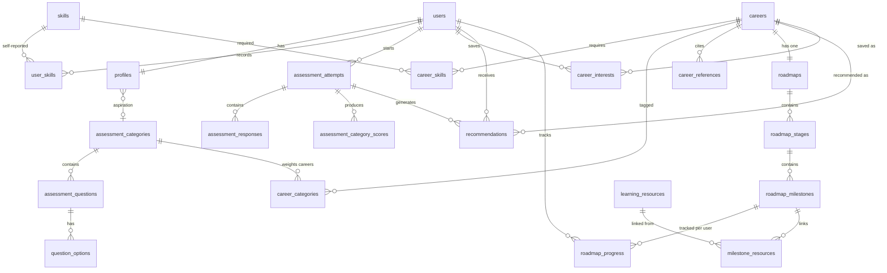

# CNA — Database Design (MySQL 8)

**Status:** Draft v0.1 — 2026-10-14 — awaiting review

---

## 1. Conventions

- Engine InnoDB; charset `utf8mb4`, collation `utf8mb4_0900_ai_ci`.
- `snake_case` table and column names; primary keys `id BIGINT UNSIGNED AUTO_INCREMENT` unless noted.
- Timestamps `DATETIME` in UTC (`created_at`, `updated_at` where meaningful).
- Foreign keys always named and explicit; delete rules noted per table.
- All migrations via Alembic (Flask-Migrate) — forward-only, committed to the repo; no manual `CREATE TABLE` on shared schemas.
- Seed data applied by idempotent seed scripts (`app/seed/`), safe to re-run.

## 2. Entity-relationship diagram (core relationships)

## 3. Tables

### 3.1 `users`
| Column | Type | Constraints |
|---|---|---|
| id | BIGINT UNSIGNED | PK, AUTO_INCREMENT |
| email | VARCHAR(255) | NOT NULL, UNIQUE (stored lower-case) |
| password_hash | VARCHAR(255) | NOT NULL |
| full_name | VARCHAR(120) | NOT NULL |
| role | ENUM('student','admin') | NOT NULL DEFAULT 'student' |
| is_active | TINYINT(1) | NOT NULL DEFAULT 1 |
| created_at / updated_at | DATETIME | NOT NULL, defaults |

### 3.2 `profiles` (1:1 with users)
| Column | Type | Constraints |
|---|---|---|
| user_id | BIGINT UNSIGNED | PK, FK → users.id ON DELETE CASCADE |
| education_level | ENUM('undergraduate','postgraduate','recent_graduate','other') | NULL |
| year_of_study | TINYINT | NULL, CHECK 1–5 |
| graduation_year | SMALLINT | NULL |
| career_aspiration | VARCHAR(200) | NULL — free text |
| aspiration_category_id | BIGINT UNSIGNED | NULL, FK → assessment_categories.id ON DELETE SET NULL |
| learning_preference | ENUM('structured_courses','self_taught_reading','video_tutorials','hands_on_projects','mixed') | NULL |
| bio | TEXT | NULL |
| updated_at | DATETIME | NOT NULL |

### 3.3 `skills` (admin-managed catalogue)
| Column | Type | Constraints |
|---|---|---|
| id | BIGINT UNSIGNED | PK |
| name | VARCHAR(100) | NOT NULL, UNIQUE |
| category | VARCHAR(50) | NOT NULL (e.g. programming_language, framework, data, cloud_devops, security, networking, database, design, testing, tools) |
| is_active | TINYINT(1) | NOT NULL DEFAULT 1 — deactivate instead of deleting when in use |
| created_at | DATETIME | NOT NULL |

### 3.4 `user_skills` (self-reported)
| Column | Type | Constraints |
|---|---|---|
| id | BIGINT UNSIGNED | PK |
| user_id | BIGINT UNSIGNED | NOT NULL, FK → users.id CASCADE |
| skill_id | BIGINT UNSIGNED | NOT NULL, FK → skills.id RESTRICT |
| status | ENUM('has','learning','want') | NOT NULL |
| proficiency | TINYINT | NULL, CHECK 1–5 |
| created_at / updated_at | DATETIME | NOT NULL |

UNIQUE (user_id, skill_id). **Absence of a row means "not assessed"** — a first-class concept for skills-gap analysis (FR-E2).

### 3.5 `assessment_categories`
| Column | Type | Constraints |
|---|---|---|
| id | BIGINT UNSIGNED | PK |
| key | VARCHAR(40) | NOT NULL, UNIQUE (e.g. `ai_ml`) |
| name | VARCHAR(80) | NOT NULL |
| description | TEXT | NULL |
| display_order | TINYINT | NOT NULL DEFAULT 0 |
| is_active | TINYINT(1) | NOT NULL DEFAULT 1 |

### 3.6 `assessment_questions`
| Column | Type | Constraints |
|---|---|---|
| id | BIGINT UNSIGNED | PK |
| category_id | BIGINT UNSIGNED | NOT NULL, FK → assessment_categories.id RESTRICT |
| text | TEXT | NOT NULL |
| question_order | SMALLINT | NOT NULL |
| is_active | TINYINT(1) | NOT NULL DEFAULT 1 — deactivation preserves history |
| created_at / updated_at | DATETIME | NOT NULL |

INDEX (category_id, question_order).

### 3.7 `question_options`
| Column | Type | Constraints |
|---|---|---|
| id | BIGINT UNSIGNED | PK |
| question_id | BIGINT UNSIGNED | NOT NULL, FK → assessment_questions.id CASCADE |
| text | VARCHAR(200) | NOT NULL |
| score_value | TINYINT | NOT NULL, CHECK 0–3 |
| option_order | TINYINT | NOT NULL |

UNIQUE (question_id, option_order).

### 3.8 `assessment_attempts`
| Column | Type | Constraints |
|---|---|---|
| id | BIGINT UNSIGNED | PK |
| user_id | BIGINT UNSIGNED | NOT NULL, FK → users.id CASCADE |
| status | ENUM('in_progress','completed') | NOT NULL DEFAULT 'in_progress' |
| started_at | DATETIME | NOT NULL |
| completed_at | DATETIME | NULL |

INDEX (user_id, status). A user has at most one `in_progress` attempt (service-enforced).

### 3.9 `assessment_responses`
| Column | Type | Constraints |
|---|---|---|
| id | BIGINT UNSIGNED | PK |
| attempt_id | BIGINT UNSIGNED | NOT NULL, FK → assessment_attempts.id CASCADE |
| question_id | BIGINT UNSIGNED | NOT NULL, FK → assessment_questions.id RESTRICT |
| option_id | BIGINT UNSIGNED | NOT NULL, FK → question_options.id RESTRICT |
| answered_at | DATETIME | NOT NULL |

UNIQUE (attempt_id, question_id) — upsert semantics for autosave.

### 3.10 `assessment_category_scores`
| Column | Type | Constraints |
|---|---|---|
| id | BIGINT UNSIGNED | PK |
| attempt_id | BIGINT UNSIGNED | NOT NULL, FK → assessment_attempts.id CASCADE |
| category_id | BIGINT UNSIGNED | NOT NULL, FK → assessment_categories.id RESTRICT |
| raw_score | TINYINT | NOT NULL |
| normalized_score | DECIMAL(5,2) | NOT NULL, CHECK 0–100 |

UNIQUE (attempt_id, category_id).

### 3.11 `careers`
| Column | Type | Constraints |
|---|---|---|
| id | BIGINT UNSIGNED | PK |
| slug | VARCHAR(80) | NOT NULL, UNIQUE |
| title | VARCHAR(120) | NOT NULL |
| summary | VARCHAR(300) | NOT NULL |
| description | TEXT | NOT NULL |
| responsibilities | JSON | NOT NULL (array of strings) |
| foundational_knowledge | JSON | NOT NULL (array) |
| related_technologies | JSON | NOT NULL (array) |
| suggested_projects | JSON | NOT NULL (array of {title, description}) |
| is_published | TINYINT(1) | NOT NULL DEFAULT 0 — drafts hidden from students |
| created_at / updated_at | DATETIME | NOT NULL |

### 3.12 `career_categories` (engine weights)
| Column | Type | Constraints |
|---|---|---|
| career_id | BIGINT UNSIGNED | PK part, FK → careers.id CASCADE |
| category_id | BIGINT UNSIGNED | PK part, FK → assessment_categories.id RESTRICT |
| weight | DECIMAL(3,2) | NOT NULL — primary 1.00, secondary 0.60 |

### 3.13 `career_skills` (engine weights)
| Column | Type | Constraints |
|---|---|---|
| career_id | BIGINT UNSIGNED | PK part, FK → careers.id CASCADE |
| skill_id | BIGINT UNSIGNED | PK part, FK → skills.id CASCADE |
| importance | ENUM('core','supporting') | NOT NULL |

### 3.14 `career_references`
| Column | Type | Constraints |
|---|---|---|
| id | BIGINT UNSIGNED | PK |
| career_id | BIGINT UNSIGNED | NOT NULL, FK → careers.id CASCADE |
| title | VARCHAR(200) | NOT NULL |
| url | VARCHAR(500) | NOT NULL |
| source_type | VARCHAR(50) | NULL |
| added_at | DATETIME | NOT NULL |

### 3.15 `recommendations`
| Column | Type | Constraints |
|---|---|---|
| id | BIGINT UNSIGNED | PK |
| user_id | BIGINT UNSIGNED | NOT NULL, FK → users.id CASCADE |
| attempt_id | BIGINT UNSIGNED | NOT NULL, FK → assessment_attempts.id CASCADE |
| career_id | BIGINT UNSIGNED | NOT NULL, FK → careers.id CASCADE |
| total_score | DECIMAL(5,2) | NOT NULL |
| tier | ENUM('strong','moderate','explore') | NOT NULL |
| rank | SMALLINT | NOT NULL |
| explanation | JSON | NOT NULL — factor snapshot (docs/recommendation-methodology.md §5) |
| created_at | DATETIME | NOT NULL |

UNIQUE (attempt_id, career_id); INDEX (user_id, created_at). Refresh replaces the set for that attempt in one transaction.

### 3.16 `career_interests`
| Column | Type | Constraints |
|---|---|---|
| id | BIGINT UNSIGNED | PK |
| user_id | BIGINT UNSIGNED | NOT NULL, FK → users.id CASCADE |
| career_id | BIGINT UNSIGNED | NOT NULL, FK → careers.id CASCADE |
| status | ENUM('interested','following','archived') | NOT NULL DEFAULT 'interested' |
| created_at / updated_at | DATETIME | NOT NULL |

UNIQUE (user_id, career_id). `following` activates roadmap tracking.

### 3.17 `roadmaps` (one per career)
| Column | Type | Constraints |
|---|---|---|
| id | BIGINT UNSIGNED | PK |
| career_id | BIGINT UNSIGNED | NOT NULL, FK → careers.id CASCADE, UNIQUE |
| title | VARCHAR(150) | NOT NULL |
| description | TEXT | NULL |

### 3.18 `roadmap_stages`
| Column | Type | Constraints |
|---|---|---|
| id | BIGINT UNSIGNED | PK |
| roadmap_id | BIGINT UNSIGNED | NOT NULL, FK → roadmaps.id CASCADE |
| stage_order | TINYINT | NOT NULL |
| title | VARCHAR(150) | NOT NULL |
| stage_type | ENUM('foundation','core_skills','tools','projects','portfolio','next_steps') | NOT NULL |
| description | TEXT | NULL |

UNIQUE (roadmap_id, stage_order).

### 3.19 `roadmap_milestones`
| Column | Type | Constraints |
|---|---|---|
| id | BIGINT UNSIGNED | PK |
| stage_id | BIGINT UNSIGNED | NOT NULL, FK → roadmap_stages.id CASCADE |
| milestone_order | SMALLINT | NOT NULL |
| title | VARCHAR(200) | NOT NULL |
| description | TEXT | NOT NULL |
| is_project | TINYINT(1) | NOT NULL DEFAULT 0 |

UNIQUE (stage_id, milestone_order).

### 3.20 `learning_resources`
| Column | Type | Constraints |
|---|---|---|
| id | BIGINT UNSIGNED | PK |
| title | VARCHAR(200) | NOT NULL |
| url | VARCHAR(500) | NOT NULL |
| resource_type | ENUM('documentation','course','video','book','article','tool','other') | NOT NULL |
| description | VARCHAR(500) | NULL |
| is_verified | TINYINT(1) | NOT NULL DEFAULT 1 |
| created_by | BIGINT UNSIGNED | NULL, FK → users.id SET NULL |
| created_at | DATETIME | NOT NULL |

### 3.21 `milestone_resources` (join)
| Column | Type | Constraints |
|---|---|---|
| milestone_id | BIGINT UNSIGNED | PK part, FK → roadmap_milestones.id CASCADE |
| resource_id | BIGINT UNSIGNED | PK part, FK → learning_resources.id CASCADE |

### 3.22 `roadmap_progress`
| Column | Type | Constraints |
|---|---|---|
| id | BIGINT UNSIGNED | PK |
| user_id | BIGINT UNSIGNED | NOT NULL, FK → users.id CASCADE |
| milestone_id | BIGINT UNSIGNED | NOT NULL, FK → roadmap_milestones.id CASCADE |
| status | ENUM('not_started','in_progress','completed') | NOT NULL DEFAULT 'not_started' |
| started_at / completed_at | DATETIME | NULL |
| updated_at | DATETIME | NOT NULL |

UNIQUE (user_id, milestone_id).

### 3.23 `sessions`
Managed automatically by Flask-Session's SQLAlchemy backend (opaque session IDs, server-side payload). No manual design; covered by tests.

## 4. Data integrity rules

1. Deleting a user cascades to **all** personal records (profile, skills, attempts, responses, scores, interests, recommendations, progress, sessions) — account deletion is complete (FR-A8).
2. `RESTRICT` on question/option/category/skill FKs from responses and links: historical assessment data is never silently orphaned; admins deactivate content instead (FR-I3).
3. Career content (careers, references, roadmaps) cascades from `careers`; skills catalogue entries are never hard-deleted while referenced (FR-I2).
4. One `in_progress` attempt per user (service-enforced, plus tests).
5. Completion of an attempt requires a response to every active question (service-enforced transaction).
6. Recommendation sets are replaced atomically per attempt — no partial rankings are ever visible.

## 5. Migration and seed strategy

- **Migrations:** Alembic revisions land increment-by-increment alongside features (not one big dump), each reviewable and runnable via `flask db upgrade`.
- **Seeds:** `app/seed/` provides `seed_skills`, `seed_assessment`, `seed_careers`, `seed_roadmaps`, `create_admin` — each idempotent (natural-key upserts), re-runnable, with counts logged. Seeds are data, not migrations, so content fixes don't require schema revisions.
- **Test database:** `cna_test` schema, created/dropped by pytest fixtures; integration tests never touch the dev schema.

## 6. Representative queries (verification anchors)

- Latest completed attempt scores: `assessment_category_scores JOIN assessment_attempts` on user, `status='completed'`, `ORDER BY completed_at DESC LIMIT 1`.
- Skills gap: `career_skills JOIN skills LEFT JOIN user_skills ON (skill_id, user_id)` → classify per FR-E1.
- Dashboard progress: `roadmap_progress` counts by status grouped per followed career's roadmap.
